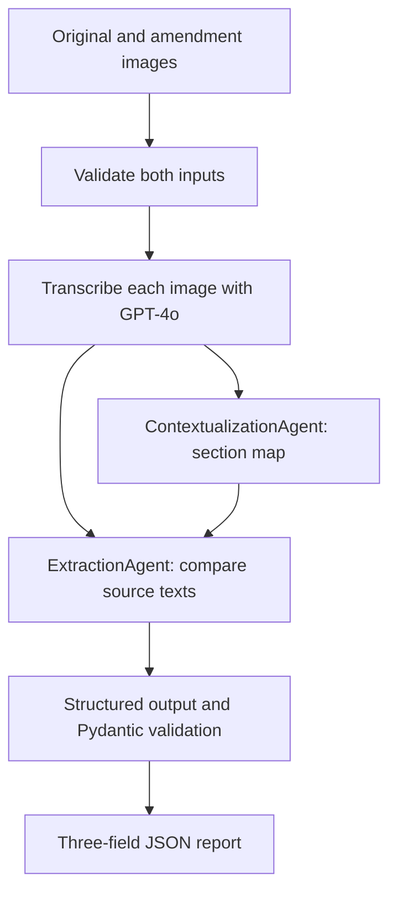

# LegalMove — Contract Analyzer

LegalMove compares an original contract and an amendment supplied as JPEG or
PNG images. It transcribes both documents with GPT-4o, coordinates two
specialized LangChain agents, and returns a JSON report validated with Pydantic.
Langfuse records the workflow, model generations, inputs, outputs, and usage.

This is an academic prototype. Its output does not replace professional legal
review, and schema validation does not establish factual or legal accuracy.

## Business context

LegalMove supports the review of an original contract against a subsequent
amendment. Reviewers need to identify which provisions changed, the topics
affected, and the relevant previous and new conditions.

Document numbering can differ between an original contract and its
amendment. A partial amendment can also leave provisions unmentioned without
removing them. These characteristics make a purely visual or line-by-line
comparison insufficient for describing substantive changes.

The prototype turns image-based document pairs into a concise, structured
change report while retaining intermediate transcriptions and a contextual
map for inspection. Human review remains necessary to confirm that the
report accurately reflects the supplied documents.

## Features and scope

- Validate both input images before making model requests.
- Preserve clause numbering, amounts, dates, currencies, and negations during
  transcription; mark unreadable fragments as `[ILEGIBLE]`.
- Map original and amendment sections with `ContextualizationAgent`.
- Identify substantive modifications, additions, explicit deletions, and
  supported absences from clearly complete revised versions.
- Export exactly three required fields as validated JSON.
- Trace successful workflows and failures under one Langfuse root.
- Run offline regression tests and separate, opt-in API evaluations.

The CLI accepts user-provided image paths, not only the included fixtures.
Each input represents one image; multi-page document assembly, PDF ingestion,
a web interface, RAG, and vector databases are not implemented.

## Architecture



The extractor receives both full transcriptions and the contextual map. The map
guides alignment but does not replace the source documents. Clauses omitted
from a partial amendment are not automatically considered deleted.

The agents have separate classes and system prompts. They run as explicit
LangChain chains; no autonomous tool loop or LangGraph is required. Separation
helps inspect alignment and extraction independently, but does not by itself
prove better accuracy than a single-agent approach.

A successful workflow without retries makes four model calls: two vision
requests and one request per agent. Dependent stages stop when an earlier stage
fails. The pipeline does not retry the entire workflow.

## Requirements and installation

- Python 3.12; the exact setup version is recorded in `.python-version`.
- An OpenAI API key with access to the configured models and API billing.
- A Langfuse project, its API credentials, and its regional base URL.
- Network access for real analysis; offline tests need no real credentials.

From a local checkout of this repository:

```bash
git clone https://github.com/crisar0790/legalmove-contract-analyzer.git
cd legalmove-contract-analyzer
python3.12 -m venv .venv
source .venv/bin/activate
python -m pip install -r requirements-dev.txt
python -m pip check
```

On Windows, activate the environment with `.venv\Scripts\Activate.ps1` in
PowerShell. Runtime-only installation uses `requirements.txt`; development
tools are pinned in `requirements-dev.txt`, which includes runtime dependencies.

## Configuration

```bash
cp .env.example .env
```

Complete credentials in `.env`. Never commit that file. Configuration is loaded
explicitly, with process environment variables taking precedence over `.env`.
The project `.env` is resolved from the source location, not an accidental
working directory. Loading settings does not make network requests.

| Variable | Purpose | Current default or example |
| --- | --- | --- |
| `OPENAI_API_KEY` | OpenAI credential | Required |
| `LANGFUSE_PUBLIC_KEY` | Langfuse project public key | Required |
| `LANGFUSE_SECRET_KEY` | Langfuse project secret key | Required |
| `LANGFUSE_HOST` | Regional Langfuse base URL | Required; for example `https://cloud.langfuse.com` for EU |
| `VISION_MODEL` | Image transcription model | `gpt-4o` |
| `AGENT_MODEL` | Model for both agents | `gpt-6-luna` |
| `REQUEST_TIMEOUT_SECONDS` | Timeout per HTTP attempt | `60` |
| `MAX_RETRIES` | Additional attempts for transient API errors | `2`; zero is valid |
| `VISION_MAX_OUTPUT_TOKENS` | Vision output budget | `4096` |
| `CONTEXT_MAX_OUTPUT_TOKENS` | Context agent output budget | `2048` |
| `EXTRACTION_MAX_OUTPUT_TOKENS` | Extraction agent output budget | `2048` |
| `MAX_IMAGE_SIZE_BYTES` | Maximum encoded-file input size in bytes | `10000000` |

Use the base URL for your actual Langfuse region, without `/api/public`.
`LANGFUSE_HOST` is explicitly mapped to the SDK's `base_url` parameter.
Agent clients use Responses API and reasoning effort `low`; this setting is
currently supplied by the client factory rather than an environment variable.
Agent output budgets cover reasoning and visible output tokens.

Configurable model names do not imply universal model compatibility.
The agent factory sends Responses API reasoning parameters and requires
structured-output support. Other models may require client changes.

### Model selection

The selected configuration is GPT-4o for vision and GPT-6 Luna for both agents.
GPT-6.1 Sol was the initial evaluation baseline. Luna was selected after review
of the two baseline text pairs and five additional semantic cases with the
refined contextualization prompt.

The lifecycle documentation checked during selection lists GPT-4o as deprecated,
with API removal scheduled for January 14, 2027. It remains configured to
preserve the assignment requirement. Any
replacement must be reconciled with that requirement.

See [model selection](docs/model-selection.md) and
[technical decisions](docs/technical-decisions.md) for evidence, tradeoffs,
settings, limitations, and official sources.

## Command-line usage

Run from the repository root with the virtual environment active:

```bash
python -m src.main --help
mkdir -p outputs
```

Simple case:

```bash
python -m src.main \
  data/test_contracts/simple_original.png \
  data/test_contracts/simple_amendment.png \
  --output outputs/simple.json
```

Complex case:

```bash
python -m src.main \
  data/test_contracts/complex_original.png \
  data/test_contracts/complex_amendment.png \
  --output outputs/complex.json
```

Other documents, including paths containing spaces:

```bash
python -m src.main \
  "/path/to/original contract.png" \
  "/path/to/contract amendment.jpg" \
  --output outputs/custom.json \
  --verbose
```

The last command is a template: replace both paths with existing files.
Omit `--output` to print the report without saving a file. The destination
directory must already exist and the output path must differ from both inputs.
Existing reports are replaced only after analysis succeeds and the complete
report is written to a temporary file.

Successful analysis writes only JSON to stdout. Trace IDs, errors, and
diagnostics go to stderr; both streams may appear together in a terminal.
`--verbose` displays the configured models and additional failure diagnostics.

```bash
python -m json.tool outputs/simple.json
```

| Exit code | Meaning |
| --- | --- |
| `0` | Analysis and requested report writing succeeded |
| `1` | Configuration, analysis, telemetry, or output failure |
| `2` | Invalid command-line arguments |

Real analysis consumes OpenAI API usage and sends telemetry to Langfuse.

## Output contract

`ContractChangeOutput` contains exactly these required fields:

| Field | Type | Meaning |
| --- | --- | --- |
| `sections_changed` | `list[str]` | Identifiers of substantively modified, added, explicitly deleted, or conclusively absent provisions in a clearly complete revised version |
| `topics_touched` | `list[str]` | Topics affected by the changes |
| `summary_of_the_change` | `str` | Supported changes, relevant previous/new values, and material uncertainty |

Example from the reviewed Luna text-based comparison:

```json
{
  "sections_changed": ["Cláusula 3"],
  "topics_touched": ["Condiciones de pago"],
  "summary_of_the_change": "Modificación de la cláusula 3, efectiva a partir del 1 de julio de 2026: el pago mensual aumenta de USD 500 a USD 650 y la fecha de vencimiento cambia del día 5 al día 10 de cada mes. La adenda ratifica que las demás cláusulas permanecen vigentes sin modificaciones."
}
```

Pydantic rejects extra fields, missing fields, incorrect types, blank list
items, and blank summaries. Empty lists are valid for a conclusive no-change
case. Text is not automatically trimmed or deduplicated by the schema.
The prompts request Spanish maps, topics, and summaries while transcription
preserves the original language.

`PipelineResult` is an internal container holding the validated analysis,
optional trace ID, transcriptions, and contextual map. These additional fields
are not part of the public JSON report.

## Validation and error handling

Both input images are checked locally for existence, readability, byte size,
actual JPEG/PNG content, and successful decoding. MIME detection uses content,
not filename extensions. Validated bytes are sent as base64 data URIs with
high image detail. No traditional OCR engine is used.

`parse_contract_image()` returns text; `parse_contract_document()` also retains
the returned model, response ID, completion status, usage when available, and
latency. Unreadable fragments must remain uncertain rather than being silently
completed.

SDK retries are disabled. The shared wrapper retries eligible connection
failures, timeouts, HTTP 408/409/429, and server errors with bounded backoff.
Each logical call permits at most `MAX_RETRIES + 1` attempts. A per-attempt
timeout is not a global workflow deadline.

Refusals, incomplete responses, empty outputs, and structured validation
failures do not produce successful reports. There is no automatic repair or
invented field completion. Application API error messages omit provider bodies.

## Langfuse observability

The CLI calls `analyze_contracts_traced()`, creating one `contract-analysis`
root before input validation. Its stages are `validate_inputs`,
`parse_original_contract`, `parse_amendment_contract`,
`contextualization_agent`, and `extraction_agent`.

Vision requests have manually recorded generations, including individual
retry attempts. LangChain callbacks capture agent generations and parsers.
Pydantic validation occurs inside `extract_and_validate_output`; a separate
empty post-validation span is not created. Auxiliary chain observations are
expected and should not be counted as extra LLM generations.

Vision traces retain image metadata and a data URI hash instead of base64.
Agent traces include the document transcriptions and contextual map. Use
fictional documents for public demonstrations and consider these transfers
before analyzing private documents.

The application waits up to 10 seconds for SDK flushing on success and error
paths. This does not cancel an internal flush or prove remote receipt. Inspect
the trace in the dashboard to confirm delivery, hierarchy, model usage, and
error states. If analysis and flushing both fail, the analysis error is
preserved and the telemetry failure is logged separately.

The SDK may log or suppress remote export failures without raising an
exception to the application. A successful exit therefore does not
guarantee telemetry delivery. Available trace IDs are logged on traced
workflow failures; failures before trace creation have no trace ID.

Untraced `analyze_contracts()` and injected pipeline components are available
for offline tests; their trace IDs remain unset.

## Tests and evaluation

Offline checks make no real model calls:

```bash
python -m pytest
python -m ruff check .
python -m ruff format --check src tests evaluation
```

Tests cover configuration, image validation, strict output types, API retry
bounds, unusable responses, agent handoff, pipeline failures, CLI streams and
exit codes, report replacement, telemetry handling, and evaluation metrics.
Mocks establish implementation behavior, not model comprehension.

Real evaluations are separate and consume API usage:

```bash
python -m evaluation.run_evaluation
python -m evaluation.compare_agents --model gpt-6-luna
python -m evaluation.run_semantic_evaluation --model gpt-6-luna
```

`run_evaluation` runs vision and both agents using the currently configured
models. It replaces `evaluation/report.json`, `evaluation/runs/` case evidence,
and selected files in `outputs/examples/`; archive earlier evidence before
rerunning it. `--case simple` or `--case complex` runs only that pair and produces
a report containing only that selection.

`compare_agents` reuses reviewed baseline transcriptions, excluding vision.
`run_semantic_evaluation` uses `evaluation/semantic_cases.json`. Both save new
timestamped evidence directories. Execution success and section metrics do not
automatically approve semantic criteria; manual review remains separate.

### Reviewed evidence

For the latest delivery findings, the complex-case alignment failure,
and its targeted correction, see
[the evaluation review](docs/evaluation.md#latest-delivery-review-and-targeted-correction).
Historical runs do not constitute a full regression of the latest prompt.

| Evaluation | Configuration | Observed result |
| --- | --- | --- |
| Two image pairs | GPT-4o + GPT-6.1 Sol | Correct sections, nine expected facts, faithful transcriptions |
| Same reviewed text pairs | GPT-6 Luna, refined context prompt | Correct sections, complete findings, corrected ratification alignment |
| Five additional text cases | GPT-6 Luna, refined context prompt | All 13 prepared criteria passed manual review |
| Final clean-checkout image verification | GPT-4o + GPT-6 Luna | Both reports reviewed; expected sections and details confirmed; models and traces verified |

Subsequent verification on November 1, 2026 passed all 187 offline tests,
Ruff linting, and formatting checks. The latest nine-case semantic run
passed its 29 prepared content-review criteria; its no-change map contains
an unnecessary scope warning, while the final report is correct.

The three course-provided image pairs were also executed, with case 1
rerun after scope-classification refinement. See
[course evidence](evaluation/course_runs/20261101/README.md) and
[evaluation status](evaluation/README.md) for details.

The earlier five-case results and clean-checkout verification below
describe their respective historical configurations.

The nine semantic cases cover no changes, partial amendments, different
numbering, an unreadable amount, embedded instructions, complete rewrites,
absent provisions, uncertain scope, and non-substantive renumbering.
Text-based cases do not evaluate image transcription quality.

The October 31 end-to-end verification was completed from a clean checkout on
October 31, 2026, using GPT-4o for vision and GPT-6 Luna for both agents.
Both image pairs produced manually reviewed reports with the expected
sections and change details. Both Langfuse traces were inspected, including
the four expected model generations and their configured models.

The clean checkout passed dependency compatibility checks, Ruff linting,
format checks, and all 182 offline tests.

Trace review flags record only traces actually inspected.
Agent usage is available in Langfuse but not collected in the local
evaluation report. No general accuracy percentage or speedup is claimed.

See [evaluation notes](docs/evaluation.md),
[evaluation instructions](evaluation/README.md), and
[fixture references](data/test_contracts/reference/).

## Project structure

| Path | Responsibility |
| --- | --- |
| `src/main.py` | CLI, output files, stdout/stderr, and exit codes |
| `src/config.py` | Explicit environment loading and configuration validation |
| `src/models.py` | Strict public Pydantic output schema |
| `src/image_parser.py` | Image validation, base64 encoding, and transcription |
| `src/llm_client.py` | Client factories, retries, and agent response checks |
| `src/agents/contextualization_agent.py` | Section inventories and correspondences |
| `src/agents/extraction_agent.py` | Supported changes and structured output acceptance |
| `src/pipeline.py` | Stage ordering, handoff, and traced execution |
| `src/observability.py` | Langfuse sessions, stages, vision generations, and flushing |
| `src/exceptions.py` | Domain exceptions |
| `prompts/` | Separate versioned system prompts |
| `data/test_contracts/` | Four fictional images and manual references |
| `tests/` | Offline regression tests |
| `evaluation/` | Real evaluation scripts, reports, and intermediate evidence |
| `outputs/examples/` | Initial GPT-6.1 Sol image-evaluation reports |
| `docs/` | Evaluation, model selection, and technical decisions |

## Limitations

- Small synthetic datasets do not establish performance on arbitrary contracts.
- Blurred scans, handwriting, and long documents have not been established as
  reliable inputs. Budgets may require adjustment for longer documents.
- Pydantic validates structure; supported meaning requires source review.
- Prompt instructions and one injection test do not guarantee resistance to
  adversarial document content.
- Two agents were not benchmarked against a single-agent implementation.
- Model aliases, service behavior, availability, and prices can change.
- Telemetry submission is asynchronous; a local trace ID alone is not proof
  of a complete remotely stored trace.
